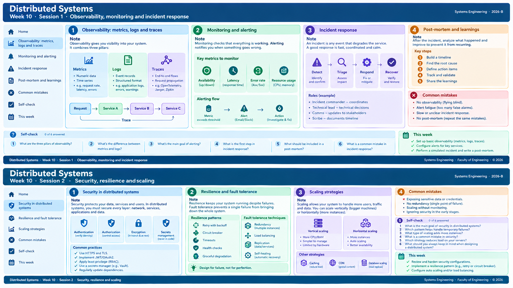

<!-- HU-STATUS TEMPLATE - do NOT remove the <!-- ... --> markers or the table headers.
     Your weekly grade is read AUTOMATICALLY from this file:
       10-week/hu-status/README.md  (inside YOUR fork). English. -->

# Weekly Status - Week 10

<!-- CONFIG-START - must match your profile repo (username/username) CONFIG -->
- FULL_NAME: Nicolas Obregón Rojas
- GITHUB_USER: nicolas1250
- TEAM: CineSync Platform
- SPRINT_GOAL: Complete the ticketing portal release 2.0.0 in csp-ticketing-portal: finalize the ticket screen, token validation and deployment support, document the release in the changelog, and prepare the QA/main promotion flow with the required release traceability.
<!-- CONFIG-END -->
| HU ID | Title | Status (todo/doing/done) | Evidence (PR or commit URL) |
|---|---|---|---|
| HU-FE-TICKETING-001 | Ticketing portal 2.0.0 release: ticket screen, token validation, Docker deployment and changelog | done | PRs #21, #22, #23, #24, #25, #27, #28, #29, #30, #31, #32, #33; commit `c0c61fb` (`docs(changelog): add v2.0.0 changelog`); commit `8adde44` (`fix(ticketing): fix the dockerfile`); commit `9f7b4b7` (`chore(ticketing): #33 promote changelog and Dockerfile update to qa`) |

## 2. My individual contribution

Main repository: `code-corhuila/csp-ticketing-portal`
Additional repos reviewed for reference: `code-corhuila/csp-auth-portal`, `code-corhuila/csp-booking-portal`, `code-corhuila/csp-concessions-portal`

### Executive summary
This week I helped complete and validate the ticketing portal release flow for version 2.0.0. I reviewed the release sequence from `develop` to `qa`, validated the promotion logic and changelog narrative, and aligned the PR descriptions with the repository conventions. I also verified the Docker deployment and CORS behavior, compared the implementation with other portals, and prepared the final release wording and commit/PR notes for the QA and main promotion flow.

### Main contributions
- Reviewed and validated the ticketing portal deployment flow and runtime config for Docker and CORS support.
- Confirmed the release order and release-branch logic:
  - feature work on `develop`
  - QA promotion through `qa-promote/...`
  - cherry-pick-based re-application into `qa`
  - release branch preparation (`release/2.0.0`) before `main`
- Helped document and align the 2.0.0 changelog in the project format.
- Reviewed the Dockerfile/Docker deployment fix and the QA promotion commit sequence.
- Drafted the PR description, changelog description, title, checklist, and release-related wording in line with repository standards.
- Verified the technical narrative behind the final release:
  - ticket screen rendering with synthetic data
  - QR code component
  - design-token alignment
  - token mirror validation work
  - Docker deployment + CORS support
- Reviewed the deployment/CORS review feedback and distinguished real blockers from release-level observations.

### Relevant changes included
- Ticket screen implementation with synthetic data and QR code.
- Visual alignment with the design system and design tokens.
- Token mirror validation and CI contract alignment.
- Docker deployment support and CORS configuration per ADR-026.
- Changelog and release documentation for 2.0.0.
- QA promotion and release branch sequencing for the final promotion to `main`.

## 3. Blockers and risks
- Intermittent Docker Hub 500 errors while pulling `node:22-alpine` during CI were not a portal logic error, but they did affect deployment validation confidence and should be monitored as an external dependency risk.
- The token-drift gate was documented as a required CI control, but the actual pipeline did not fully enforce it in the reviewed diff. This should be aligned before any future release claim is made.
- The CORS regex approach is valid within the intended trust model, but it should be treated as a hardening item if environment variable control is not strictly limited.
- Release sequencing required careful cherry-pick traceability and branch parity checks; any mismatch in the promotion trail could cause confusion in the final merge to `main`.

## 4. Plan for next week
- Finalize the `release/2.0.0` promotion to `main` and confirm the final branch parity.
- Create the `v2.0.0` tag and publish the GitHub release with the changelog summary.
- Align the CI token-drift enforcement with the stated contract so the documentation and actual automation match.
- Review the CORS hardening follow-up as a cross-portal improvement if the team wants to strengthen the runtime config beyond this release.
- Capture the final proof of merge/branch traceability and keep the promotion history clear for future releases.

## 5. Compliance self-check
- [x] Conventional Commits - `type(scope): summary`
- [x] Per-environment HU branch + PR to that environment (hu-xxx-dev -> develop, ...)
- [x] Testable acceptance criteria
- [x] Tests added/updated (unit / integration)
- [x] DDD / hexagonal boundaries respected (domain has no I/O)
- [x] No secrets; config via environment variables

## 6. Evidence links
- PR #21: https://github.com/code-corhuila/csp-ticketing-portal/pull/21
- PR #22: https://github.com/code-corhuila/csp-ticketing-portal/pull/22
- PR #23: https://github.com/code-corhuila/csp-ticketing-portal/pull/23
- PR #24: https://github.com/code-corhuila/csp-ticketing-portal/pull/24
- PR #25: https://github.com/code-corhuila/csp-ticketing-portal/pull/25
- PR #27: https://github.com/code-corhuila/csp-ticketing-portal/pull/27
- PR #28: https://github.com/code-corhuila/csp-ticketing-portal/pull/28
- PR #29: https://github.com/code-corhuila/csp-ticketing-portal/pull/29
- PR #30: https://github.com/code-corhuila/csp-ticketing-portal/pull/30
- PR #31: https://github.com/code-corhuila/csp-ticketing-portal/pull/31
- PR #32: https://github.com/code-corhuila/csp-ticketing-portal/pull/32
- PR #33: https://github.com/code-corhuila/csp-ticketing-portal/pull/33
- Commit `c0c61fb`: `docs(changelog): add v2.0.0 changelog`
- Commit `8adde44`: `fix(ticketing): fix the dockerfile`
- Commit `9f7b4b7`: `chore(ticketing): #33 promote changelog and Dockerfile update to qa`
## week 10:

