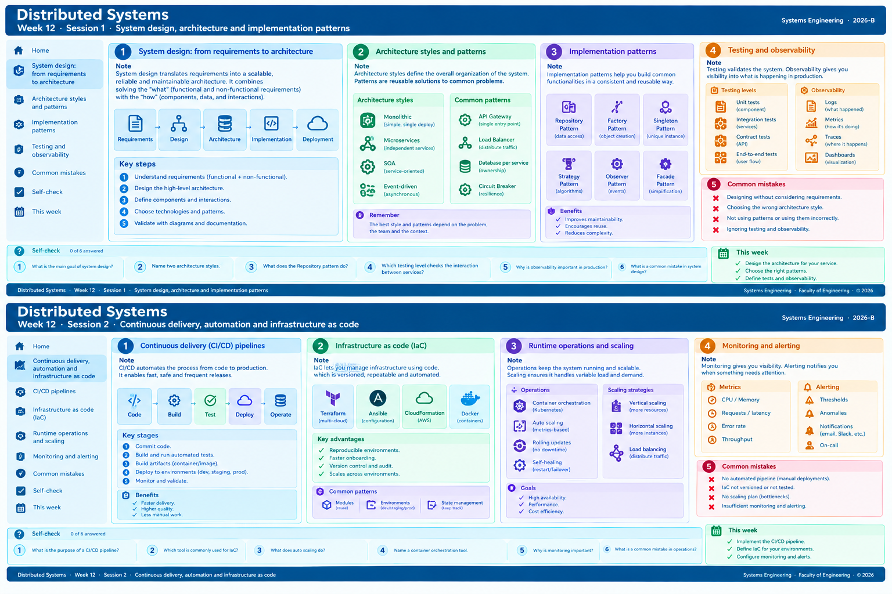

<!-- HU-STATUS TEMPLATE - do NOT remove the <!-- ... --> markers or the table headers.
     Your weekly grade is read AUTOMATICALLY from this file:
       12-week/hu-status/README.md  (inside YOUR fork). English. -->

# Weekly Status - Week 12

<!-- CONFIG-START - must match your profile repo (username/username) CONFIG -->
- FULL_NAME: Nicolas Obregon Rojas
- GITHUB_USER: nicolas1250
- TEAM: cineSync Platform
- SPRINT_GOAL: Deliver the Ticketing & Fulfillment stories HU-TICKETING-001 (contact projection) and HU-TICKETING-002 (ConcessionOrderConfirmed consumer + pending concessions + DLQ) through develop in csp-ticketing-api and csp-ticketing-db, fix the broken integration tests, and get the concession relay ready for end-to-end validation.
<!-- CONFIG-END -->

# Weekly Progress Report (October 20–24, 2026)

## 1. User Stories Worked This Week

| HU ID | Title | Status | Evidence (PR or commit URL) |
| :--- | :--- | :--- | :--- |
| **HU-TICKETING-001** | Maintain contact projection (`UserRegistered` / `UserEmailChanged`) with upsert and inbox idempotency | `doing` | `code-corhuila/csp-ticketing-api#9` (merged), `code-corhuila/csp-ticketing-api#10` (merged), `code-corhuila/csp-ticketing-db#1` (open), `code-corhuila/csp-ticketing-db#4` (merged) |
| **HU-TICKETING-002** | `ConcessionOrderConfirmed` consumer, pending concessions in DB, DLQ per ADR-007, delete only after successful merge | `doing` | `code-corhuila/csp-ticketing-api#11`, `#13`, `#14`, `#15`, `#16`, `#17` (merged); `code-corhuila/csp-ticketing-db#5`, `#6` (merged); `code-corhuila/csp-ticketing-api#12` (open, JWT norm 5.3.7) |
| **PLATFORM-TICKETING-TESTS** | Fix `ticketing-api` integration tests against real Postgres | `doing` | `code-corhuila/csp-ticketing-api` commit `6c0d411` (local branch, no PR yet); issue on `develop` `932ce6c` |

---

## 2. My Individual Contribution

### 2.1 Executive Summary

This week I closed the concessions cycle (**HU-TICKETING-002**) in `csp-ticketing-api`:
* `ConcessionOrderConfirmed` consumer.
* Persistence of pending concessions in the database (`pending_concession_order`).
* Retry and DLQ flow per **ADR-007**.
* The fix to *"delete pending only after successful merge"* (commit `932ce6c` on `develop`).

In parallel, in `csp-ticketing-db`, migrations **V001 to V006** were applied (schema `ticketing_fulfillment`, `user_contact`, `inbox_event`, `tickets`, `ticketing_fulfillments`, `pending_concession_order`).

In `csp-ticketing-api`, the Auth events consumer (**HU-TICKETING-001**) also advanced, as well as consumer resilience (cancel recovery, queue redeclaration, readiness).

> **Infrastructure Note:** Everything was validated locally. GitHub Actions for the organization has been blocked by billing since 2026-10-14, so merges were justified with one comment per Pull Request and tested in Docker locally.

### 2.2 Week Matrix - Consolidated State

| Repository | PRs Opened by Me | Merged | Open | Issues Opened by Me | State of the Work |
| :--- | :---: | :---: | :---: | :--- | :--- |
| **`csp-ticketing-api`** | 10 (`#8` to `#17`) | 9 | 1 (`#12`) | 2 open (`#1` contact, `#12` JWT) | `ConcessionOrderConfirmed` consumer on `develop`; tests broken on `932ce6c` (commit `6c0d411` on local branch without PR) |
| **`csp-ticketing-db`** | 6 (`#1` to `#6`) | 5 | 1 (`#1`) | 1 open (`#1` DB story) | V001–V006 on `develop`; schema ready for `qa` |
| **Total** | **16** | **14** | **2** | **3** | — |

### 2.3 Pull Requests by Story (All Opened by Me, Merged Unless Noted)

| Story | Repository | Develop PRs | Promotion to `qa` |
| :--- | :--- | :--- | :--- |
| **HU-TICKETING-002** *(issue `csp-docs#5`)* | `csp-ticketing-api` | `#11` (Option B, only Ticket + Fulfillment PENDING, internal endpoint), `#13` (`ConcessionOrderConfirmed` consumer), `#14` (improvements: dedup, field mapping, routing key), `#15` (3 issues: flexible payload, persistent pending, retry/DLQ), `#16` (DB persistence + DLQ for invalid payloads), `#17` (delete pending only on successful merge, commit `932ce6c`) | — |
| **HU-TICKETING-002** *(issue `csp-docs#5`)* | `csp-ticketing-db` | `#4` (V002 `user_contact` + V003 `inbox_event`), `#5` (V004 `tickets` + V005 `ticketing_fulfillments`), `#6` (V006 `pending_concession_order`) | — |
| **HU-TICKETING-001** *(issue `csp-docs#4`)* | `csp-ticketing-api` | `#8` (Spring Boot 3.x scaffold), `#9` (`UserRegistered`/`UserEmailChanged` consumer with upsert and inbox idempotency), `#10` (resilience: cancel recovery, redeclaration, readiness) | — |
| **HU-TICKETING-001** *(issue `csp-docs#4`)* | `csp-ticketing-db` | `#2` (docs: repository name and description) | — |
| **HU-TICKETING-001** *(issue `csp-docs#4`)* | `csp-ticketing-db` | `#1` (schema, `user_contact` projection and `inbox_event`) | Open (no promotion PR yet) |
| **Open Work** | `csp-ticketing-api` | `#12` (JWT validation norm 5.3.7) | Open |
| **Test Fix** | `csp-ticketing-api` | Commit `6c0d411` on branch `fix/concession-order-confirmed-persistence-and-dlq` (no PR yet) | Pending |

### 2.4 Documentation and Decisions in `csp-docs`

*References cited in ticketing PRs (no PRs by me in `csp-docs` this week, but the stories depend on them):*

| Document | Issue / PR | Status |
| :--- | :--- | :--- |
| **HU-TICKETING-002** | `csp-docs#5` | Referenced in `ticketing-api` `#13` to `#17` |
| **HU-TICKETING-001** | `csp-docs#4` | Referenced in `ticketing-api` `#9`, `#10` and `ticketing-db#1` |
| **ADR-007** (Retry/DLQ) | `csp-docs` | Cited in `ticketing-api` `#13`, `#15`, `#16` |
| **ADR-017** (Ticketing Java PostgreSQL) | `csp-docs` | Reference architecture |
| **ADR-045** (Order-independent event processing) | `csp-docs` | Cited in `ticketing-api` `#14`, `#15` |

### 2.5 Platform and Infrastructure Work

* **`csp-ticketing-db`**: Flyway migrations V001–V006 on schema `ticketing_fulfillment`, roles `ticketing_reader` / `ticketing_writer`, grants per table, rollback scripts U001–U006, and db-tests in `.github/db-tests`.
* **`csp-ticketing-api`**: Testcontainers configuration (PostgreSQL + RabbitMQ), `@ServiceConnection`, `ddl-auto: validate`, RabbitMQ retry (initial 5s, multiplier 2, max-attempts 3, DLQ), `ticketing.rabbitmq.declare-at-startup: true`.
* **`csp-ticketing-db` CI** (`.github/workflows/db-ci.yml`): Flyway validate, migrate, db-tests with `psql`, rollback and reapply — validated locally; GitHub Actions blocked by billing.

### 2.6 Quality

* **`csp-ticketing-api`**: `mvn compile` and `mvn test-compile` pass on main code. Integration tests do not run on `develop` (`932ce6c`) because:
  * `ConcessionOrderConfirmedConsumerTest` line ~290: duplicate variable `inboxEvent` in the same method → compilation error.
  * `ConsumerResilienceTest` line ~208: calls `HealthComponent.getDetails()`, which does not exist in Spring Boot 3.3.2 (`HealthEndpoint.health()` returns `HealthComponent`; must cast to `Health` to use `getDetails()`).
  * `ConsumerResilienceTest` does not start PostgreSQL, so against real Postgres with `ddl-auto: validate` it would fail if tables are not found; V001–V006 must be applied first.
* **`csp-ticketing-db`**: Flyway validate passes with V001–V006 applied; risk of duplicate V002 version (`user_contact` and `user_contacts` coexist in `sql/01_ddl/`).

### 2.7 User Stories and Issues - State at the End of the Week

| Story / Issue | Repository | State | Evidence |
| :--- | :--- | :--- | :--- |
| **HU-TICKETING-001** *(contact projection)* | `csp-ticketing-api` / `csp-ticketing-db` | `doing` - on develop; story issue `#1` of `ticketing-db` still open | `ticketing-api#9`, `#10`; `ticketing-db#4` |
| **HU-TICKETING-002** *(concessions consumer)* | `csp-ticketing-api` / `csp-ticketing-db` | `doing` - on develop; release pending | `ticketing-api#11`–`#17`; `ticketing-db#5`, `#6` |
| **JWT validation norm 5.3.7** | `csp-ticketing-api` | `open` | `ticketing-api#12` |
| **Contact projection DB** | `csp-ticketing-db` | `open` | `ticketing-db#1` |

---

## 3. Blockers and Risks

* **`mvn verify` on `develop` (`932ce6c`) does not compile tests:** `ConcessionOrderConfirmedConsumerTest` duplicates `inboxEvent` (line ~290) and `ConsumerResilienceTest` calls `HealthComponent.getDetails()` (nonexistent in Boot 3.3.2). Zero tests executed.
* **Against real Postgres with V001–V006 applied:** The test starts Postgres without migrations; with `ddl-auto: validate` it may fail if tables are missing. V001–V006 must be applied before running, or use Testcontainers with Flyway in the test.
* **`ticketing-db` version conflicts:** Two files with version `V002` (`user_contact` and `user_contacts`) → Flyway fails with *"more than one migration with version 2"*. `V001` does `COMMENT ON TABLE flyway_schema_history` before Flyway creates the control table. CI uses `flyway:undo`, not supported in Flyway Community.
* **`ticketing-api` configuration duplication:** `application.yml` has a duplicated `spring.rabbitmq` block (`host`/`port`/`listener` on one side, `connection-timeout`/`heartbeat` on the other); may override configuration at startup.
* **Release governance:** No tag or release yet; under team rules, stories remain `doing` until they reach `main` and are approved.
* **Unmerged fixes:** No PR yet for the `ConsumerResilienceTest` fix (commit `6c0d411` on local branch).

---

## 4. Plan for Next Week

1. Fix `ConcessionOrderConfirmedConsumerTest` (duplicate variable) and `ConsumerResilienceTest` (`health` without `getDetails()`; add PostgreSQL container to both integration tests).
2. Open PR for test fix in `ticketing-api` and run `mvn verify` green against real Postgres with V001–V006 applied (including the order-independent concessions test before/after `BookingConfirmed`).
3. Open cleanup PRs in `ticketing-db` (duplicate `V002`, `V001`, CI without undo).
4. Validate end-to-end relay (concessions → ticketing → worker) once tests are green.
5. Work on open issues `#1` (contact projection DB) and `#12` (JWT validation norm 5.3.7).

---

## 5. Compliance Self-Check

| Item | Status | Notes |
| :--- | :---: | :--- |
| **Conventional Commits** (`type(scope): summary`) | ✅ | `fix(api):`, `feat(db):`, `fix(test):`, `docs(db):` |
| **Per-environment HU branch + PR to that environment** | ✅ | Branch `fix/...` → `develop`; promotion with `git cherry-pick -x` to `qa`/`main` |
| **Testable acceptance criteria** | ⚠️ | Pending: integration tests must pass against real Postgres |
| **Tests added/updated (unit / integration)** | ⚠️ | `ConcessionOrderConfirmedConsumerTest`, `ConsumerResilienceTest` exist but are broken |
| **DDD / hexagonal boundaries respected** | ✅ | Core has no framework imports; adapters with JPA/RabbitMQ/SMTP |
| **No secrets; config via environment variables** | ✅ | `DB_USER`, `DB_PASSWORD`, `JWT_PUBLIC_KEY`, etc. in `application.yml` |

---

## 6. Evidence Links

### `csp-ticketing-api` (PRs and Commits)
* [PR #17](https://github.com/code-corhuila/csp-ticketing-api/pull/17) — `fix: only delete pending concession on successful merge` (`932ce6c` on develop)
* [PR #16](https://github.com/code-corhuila/csp-ticketing-api/pull/16) — `persist pending concessions to DB + fix DLQ flow`
* [PR #15](https://github.com/code-corhuila/csp-ticketing-api/pull/15) — `resolve 3 issues in ConcessionOrderConfirmed consumer`
* [PR #14](https://github.com/code-corhuila/csp-ticketing-api/pull/14) — `ConcessionOrderConfirmed consumer - HU-TICKETING-002 improvements`
* [PR #13](https://github.com/code-corhuila/csp-ticketing-api/pull/13) — `ConcessionOrderConfirmed consumer - HU-TICKETING-002`
* [PR #11](https://github.com/code-corhuila/csp-ticketing-api/pull/11) — `align ticketing-api Option B HU-TICKETING-002`
* [PR #10](https://github.com/code-corhuila/csp-ticketing-api/pull/10) — `consumer resilience for HU-TICKETING-001`
* [PR #9](https://github.com/code-corhuila/csp-ticketing-api/pull/9) — `UserRegistered/UserEmailChanged consumer for HU-TICKETING-001`
* [PR #8](https://github.com/code-corhuila/csp-ticketing-api/pull/8) — `Spring Boot 3.x multi-module scaffold`
* [Issue #12](https://github.com/code-corhuila/csp-ticketing-api/issues/12) — `JWT validation norm 5.3.7` (open)
* [Issue #1](https://github.com/code-corhuila/csp-ticketing-api/issues/1) — `contact projection consumer HU-TICKETING-001` (open)
* **Develop Commit:** [`932ce6c`](https://github.com/code-corhuila/csp-ticketing-api/commit/932ce6c)
* **Test Fix Commit:** `6c0d411` *(local branch, no PR yet)*

### `csp-ticketing-db` (PRs and Issues)
* [PR #6](https://github.com/code-corhuila/csp-ticketing-db/pull/6) — `V006/U006 pending_concession_order table`
* [PR #5](https://github.com/code-corhuila/csp-ticketing-db/pull/5) — `V004 tickets + V005 ticketing_fulfillments`
* [PR #4](https://github.com/code-corhuila/csp-ticketing-db/pull/4) — `V002 user_contact + V003 inbox_event`
* [PR #3](https://github.com/code-corhuila/csp-ticketing-db/pull/3) — `Flyway structure V001`
* [Issue #1](https://github.com/code-corhuila/csp-ticketing-db/issues/1) — `schema, user_contact projection and inbox_event` (`HU-TICKETING-001`, open)

### `csp-docs` (References Cited)
* [Issue #5](https://github.com/code-corhuila/csp-docs/issues/5) — `HU-TICKETING-002`
* [Issue #4](https://github.com/code-corhuila/csp-docs/issues/4) — `HU-TICKETING-001`

* **My PRs Search:** [GitHub PR Query](https://github.com/search?q=org%3Acode-corhuila+author%3Anicolas1250+is%3Apr+created%3A%3E%3D2026-10-20&type=pullrequests)

---

## Week Work Summary

**Week of October 20–24, 2026:** 16 Pull Requests opened (14 merged, 2 open) across 2 `code-corhuila` repositories, alongside 3 open issues. Stories **HU-TICKETING-001** and **HU-TICKETING-002** are on `develop` in `csp-ticketing-api` and `csp-ticketing-db`; migrations V001–V006 are applied. 

Integration tests of `ticketing-api` are currently failing to compile on `develop` (`932ce6c`); the fix is on local branch (`6c0d411`) awaiting PR creation. GitHub Actions has been blocked by billing since 2026-10-14, requiring all validation to be performed locally via Docker. Once integration tests pass green, end-to-end relay validation will proceed.

## week summary session 1 and 2:

