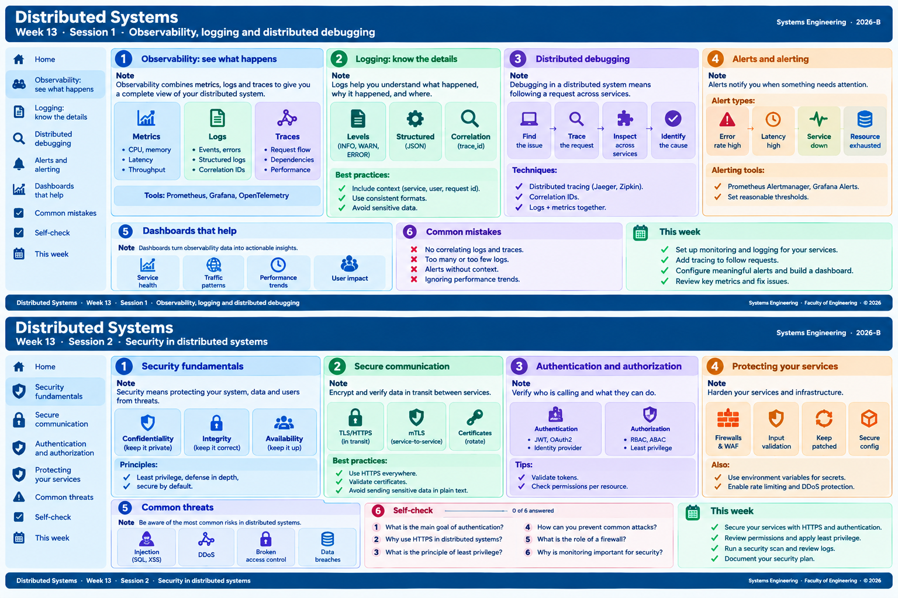

<!-- HU-STATUS TEMPLATE - do NOT remove the <!-- ... --> markers or the table headers.
     Your weekly grade is read AUTOMATICALLY from this file:
       13-week/hu-status/README.md  (inside YOUR fork). English. -->

# Weekly Status - Week 13

<!-- CONFIG-START - must match your profile repo (username/username) CONFIG -->
- FULL_NAME: Nicolas Obregon Rojas
- GITHUB_USER: nicolas1250
- TEAM: CineSync Platform
- SPRINT_GOAL: Threat model the boundary between csp-api-gateway and csp-ticketing-api (STRIDE) and turn the three highest risks into security stories with a negative authorization test in the pipeline.
<!-- CONFIG-END -->

## 1. User stories worked this week

| HU ID | Title | Status (todo/doing/done) | Evidence (PR or commit URL) |
|---|---|---|---|
| HU-TICKETING-001 | Ticketing & Fulfillment maintains a local contact projection | done (in `develop` and `qa`; story issue #214 still open) | https://github.com/code-corhuila/csp-ticketing-db/pull/10 · https://github.com/code-corhuila/csp-ticketing-api/pull/37 |
| HU-TICKETING-002 | Ticket is issued and emailed after confirmation | doing (api, db and RustFS are in `qa`; the `csp-worker` part is only in `develop`) | https://github.com/code-corhuila/csp-ticketing-api/pull/43 (stack #37 to #43), /pull/45, /pull/48 · https://github.com/code-corhuila/csp-ticketing-db/pull/11 · https://github.com/code-corhuila/csp-infra-rustfs/pull/4 · worker (`develop`): https://github.com/code-corhuila/csp-worker/pull/55 |
| HU-TICKETING-003 | Duplicate event processing does not duplicate tickets | done (in `develop` and `qa`; story issue #216 still open) | https://github.com/code-corhuila/csp-ticketing-api/pull/50 · /pull/52 · promotion: /pull/53 |
| W13-WORKSHOP | Threat modeling of csp-api-gateway to csp-ticketing-api | done | https://github.com/code-corhuila/csp-docs/pull/290 |
| SEC-S-291 | [security] ticketing-api accepts only tokens signed by csp-auth-api (S, risk 9, P0) | todo | https://github.com/code-corhuila/csp-docs/issues/291 |
| SEC-T-292 | [security] ticket PDF link can only point to CineSync object storage (T, risk 6, P1) | todo | https://github.com/code-corhuila/csp-docs/issues/292 |
| SEC-E-293 | [security] internal ticketing routes callable only by allowed services (E, risk 6, P1) | todo | https://github.com/code-corhuila/csp-docs/issues/293 |

## 2. My individual contribution

### User stories HU-TICKETING-001, 002 and 003

- HU-001 and HU-002, promotion to `qa`: re-applied the commits of both stories with `git cherry-pick -x` in stacked PRs (db #10, #11; api #37 to #43, #45, #48). The 1574-line scaffold commit of api exceeds the 400-line cap of section 9.2 and cannot be split; the exception is explained in the body of #37. Local validation (`mvn clean verify`, Testcontainers), declared in every PR because Actions is out of service.
- HU-002, Concessions review: two real defects, not only a flaky test. A concession order that arrives before the booking was never stored (a `jsonb` column written as text) and the two consumers raced. Fixed in #47 with a per-reservation advisory lock and `ConcessionBookingRaceTest` (80 concurrent pairs; red before, green after). Also tests of the ticket email (#46) and an answer on `csp-ticketing-api#5` (queue ready, no other Concessions event needed; the combo and latency questions answered by Concessions).
- HU-003: a ticket email is sent once when dispatch runs overlap (#50); inbox events are recorded atomically and the ticket is locked when its PDF is registered, so one `TicketIssued` row is written (#52); promoted in #53. End-to-end run with the real API, PostgreSQL 16, RabbitMQ 3.13 and an SMTP server in disposable containers: 7 runs, 6 clean; the failing one came from leftover state of my script, not from the code.
- Infrastructure and docs: RustFS storage promoted to `qa` (`csp-infra-rustfs#4`, CI steps replayed locally); concession event docs aligned with the code (`csp-docs#312`); issue `csp-docs#302` corrected from `csp-infra-minio` to `csp-infra-rustfs`.

### Threat modeling workshop

- CP0: claimed the boundary csp-api-gateway to csp-ticketing-api in issue #279 and created the workshop README with the CONFIG block.
- CP1: mapped the attack surface of CineSync (five trust boundaries, eight assets, six entry points of TB3) in `13-week/workshop/01-attack-surface.md`.
- CP2: wrote the STRIDE analysis of TB3 in two pushes on the branch `security/stride-nicolas1250` (PR #290). Highest risk is S (9). The row S uses the library book (Cano, p. 40).
- CP3: opened three `[security]` stories (#291, #292, #293) with the labels `security` and P0/P1.
- CP4: added `security.yml` (gitleaks, OWASP dependency-check, negative test) and `TicketingAuthzNegativeTest` in `13-week/workshop/04-security-ci/`.
- CP5: peer review comment on the STRIDE PR of Yeferson (#277), about the per-sub rate limit and the shared IP bucket in the Gateway.
- CP6: re-checked the six STRIDE rows against `develop` of csp-ticketing-api after `csp-ticketing-api#36` (token validation) and added a status section to PR #290. S and E fell from risk 9 and 6 to 3; T to 3; I (6) is now the highest open risk. No teammate had commented on the PR.
- CP7: refined the three stories with a comment each (state after #36) and linked #293 with #285 and #287, and #291 with #284.
- CP8: ran `TicketingAuthzNegativeTest` against the real service from `develop` (PostgreSQL, RabbitMQ and the migrations of csp-ticketing-db in Docker): PASS, both cases return 401. Validated `security.yml` with actionlint.
- CP9: implementation plan written in the reflection document.

## 3. Blockers and risks

- The token validation (`csp-ticketing-api#36`, closes #12) is in `qa` since 2026-10-30 (it arrived with #43) but not in `main` yet, so stories #291 and #293 stay open until `main`.
- `pdfUrl` of `POST /internal/tickets/{ticketId}/pdf` is not checked for the `s3://` prefix (#292), and `/actuator/health` still has `show-details: always` (threat I, risk 6).
- GitHub Actions is out of service, so the security gates and the CI of the PRs only run locally (the check of `csp-infra-rustfs#4` failed with "account is locked due to a billing issue"). csp-ticketing-api has no `deploy/compose.yml` to start the service in a pipeline.
- The `csp-worker` part of HU-TICKETING-002 is not in `qa`: it depends on 4 commits of HU-CONCESSIONS-004 (Concessions team) that are not promoted either; coordination pending.
- `csp-ticketing-api` cannot run in a platform environment (no Dockerfile or compose, jar without `repackage`), so the Concessions relay cannot be enabled in dev: it publishes with `mandatory` and would lose events if the queue does not exist.
- `csp-ticketing-api#18` (JWT public key of `qa` and `main`) is open: the environments `qa` and `main` do not exist yet. Both keys match their announced fingerprints.
- The story issues `csp-docs#214`, `#215` and `#216` are still open: the closing steps (update of `user-stories.md`, board cards, `release/3.0.0`) are pending.
- The policy for a PDF rendered before a late concession order is not decided (the order normally arrives about 10 seconds after the booking, with no hard maximum).
- The issues are not yet in the team board: my `gh` token lacks the project scope.

## 4. Plan for next week

- Run the negative test against `qa` (the token validation reached `qa` on 2026-10-30) and keep #291 and #293 open until `main`.
- Change `show-details` to `when-authorized` and add a test for `/actuator/health` (threat I).
- Check the `s3://` prefix of `pdfUrl` with an integration test (#292).
- Coordinate the promotion of the `csp-worker` commits of HU-TICKETING-002 (8 commits, in stacked segments) with the Concessions team.
- Close HU-TICKETING-001, 002 and 003 in order: `docs/*` PR for `user-stories.md`, close the issues with a comment, move the cards, add each HU to `release/3.0.0`.
- Create the `qa` and `main` environments of `csp-ticketing-api` and load `JWT_PUBLIC_KEY` (#18).
- Prepare the deployment of the API in dev (Dockerfile, compose, `repackage`, database login, variables).
- Record the decision on the late concession order (ADR or decision, and a technical-debt item).

## 5. Compliance self-check

- [x] Conventional Commits - `type(scope): summary`
- [ ] Per-environment HU branch + PR to that environment (hu-xxx-dev -> develop, ...)
- [x] Testable acceptance criteria
- [x] Tests added/updated (unit / integration)
- [x] DDD / hexagonal boundaries respected (domain has no I/O)
- [x] No secrets; config via environment variables

## 6. Evidence links

- Claim issue: https://github.com/code-corhuila/csp-docs/issues/279
- STRIDE pull request: https://github.com/code-corhuila/csp-docs/pull/290
- STRIDE push 1: https://github.com/code-corhuila/csp-docs/commit/e427ca7
- STRIDE push 2: https://github.com/code-corhuila/csp-docs/commit/70f8e3c
- Security stories: https://github.com/code-corhuila/csp-docs/issues/291 , https://github.com/code-corhuila/csp-docs/issues/292 , https://github.com/code-corhuila/csp-docs/issues/293
- Peer review comment: https://github.com/code-corhuila/csp-docs/pull/277#pullrequestreview-5692268822
- Fork commits: 557ef93 (CP0), e0443b4 (CP1), 693e972 (CP3), 4a6547d (CP4), c478f93 (CP7), 5df1937 (CP8)
- STRIDE update (CP6): https://github.com/code-corhuila/csp-docs/commit/83731fd
- Workshop folder: https://github.com/nicolas1250/sistemas-distribuidos-2026-b-g1/tree/main/13-week/workshop
- HU-TICKETING-001: https://github.com/code-corhuila/csp-ticketing-db/pull/10 · https://github.com/code-corhuila/csp-ticketing-api/pull/37
- HU-TICKETING-002: https://github.com/code-corhuila/csp-ticketing-api/pull/43 · https://github.com/code-corhuila/csp-ticketing-db/pull/11 · https://github.com/code-corhuila/csp-infra-rustfs/pull/4 · https://github.com/code-corhuila/csp-docs/pull/312
- HU-TICKETING-003: https://github.com/code-corhuila/csp-ticketing-api/pull/53

## 7. week 13 session 1 and 2

