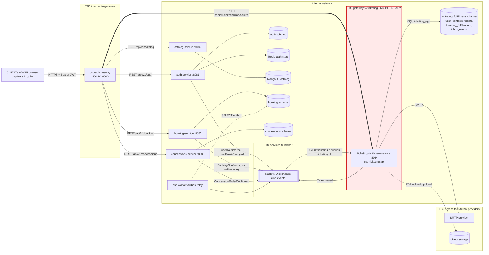

# Attack surface - CineSync Platform

Sources: `csp-docs` 03-product, 05-architecture, 07-api, 09-microservices (read 2026-10-28).
My boundary is **TB3** (API Gateway to Ticketing & Fulfillment).

| TB | Boundary | Why it is a boundary |
|---|---|---|
| TB1 | internet to `csp-api-gateway` | untrusted browser traffic enters; gateway only checks the `Authorization` header exists |
| TB2 | `csp-api-gateway` to `auth-service`, `catalog-service`, `booking-service`, `concessions-service` | other owners validate their own tokens |
| TB3 | `csp-api-gateway` to `ticketing-fulfillment-service` | **mine**; the service must validate the JWT itself (Norma 5.3.7) |
| TB4 | services to RabbitMQ `cine.events` | events are trusted by queue name only |
| TB5 | `ticketing-fulfillment-service` to SMTP and object storage | user email and ticket PDFs leave the system |

## Asset inventory

| Asset | Where it lives | Classification |
|---|---|---|
| Access token (RS256 JWT, `sub`, `permissions`) | client memory, `Authorization` header | restricted |
| `qr_payload` of a ticket | `ticketing_fulfillment.tickets` | restricted |
| User email in `user_contacts` | `ticketing_fulfillment.user_contacts` | confidential |
| Ticket PDF and `pdf_url` | object storage and `tickets.pdf_url` | confidential |
| Reservation and showtime snapshot (`reservation_id`, `showtime_id`, `seat_labels_snapshot`) | `ticketing_fulfillment.tickets` | internal |
| Delivery state and `last_error` | `ticketing_fulfillment.ticketing_fulfillments` | internal |
| `inbox_events.event_id` | `ticketing_fulfillment.inbox_events` | internal |
| SMTP and database credentials (`SMTP_USER`, `DB_PASSWORD`) | environment variables of `csp-ticketing-api` | restricted |

## Entry points of TB3

| Entry point | Caller | Authentication today |
|---|---|---|
| `GET /api/v1/ticketing/me/tickets` (`ticket:read:self`) | `csp-api-gateway` for CLIENT/ADMIN | Bearer JWT in the contract; service validation pending (`csp-ticketing-api#12`) |
| `GET /api/v1/ticketing/me/notifications` (`ticket:read:self`) | `csp-api-gateway` | same as above |
| `GET /api/v1/ticketing/health` | health checks | none |
| `GET /api/v1/ticketing/health/ready` | health checks | none; reports `database`, `broker`, `emailProvider`, `consumers` |
| `GET /actuator/health` (`show-details: always`) | anyone who reaches :8084 | none |
| `POST /internal/tickets/{ticketId}/pdf` | PDF generator (`TicketingInternalController`) | none found in code; not in the OpenAPI contract |
