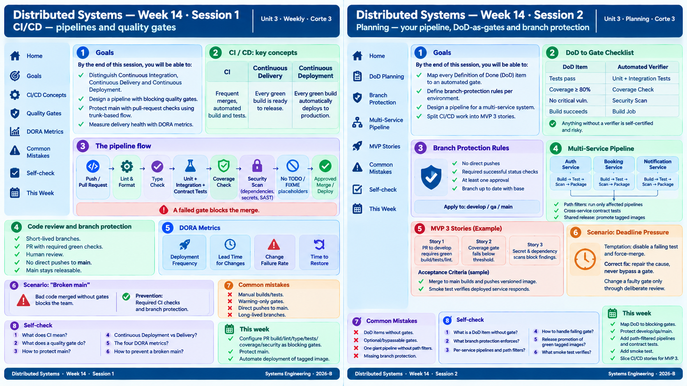

<!-- HU-STATUS TEMPLATE - do NOT remove the <!-- ... --> markers or the table headers.
     Your weekly grade is read AUTOMATICALLY from this file:
       14-week/hu-status/README.md  (inside YOUR fork). English. -->

# Weekly Status - Week 14

<!-- CONFIG-START - must match your profile repo (username/username) CONFIG -->
- FULL_NAME: Nicolas Obregon Rojas
- GITHUB_USER: nicolas1250
- TEAM: CineSync Platform
- SPRINT_GOAL: Ticketing without duplicates, secured and documented, ready to present.
<!-- CONFIG-END -->

## 1. User stories worked this week

Period covered: from the end of HU-TICKETING-001 and HU-TICKETING-002 (2026-10-29) to 2026-11-15. State checked on GitHub on 2026-11-15.

| HU ID | Title | Status (todo/doing/done) | Evidence (PR or commit URL) |
|---|---|---|---|
| HU-TICKETING-003 | Duplicate event processing does not duplicate tickets | done (story issue closed 2026-11-07; released in `v3.0.0` of `csp-ticketing-api`) | https://github.com/code-corhuila/csp-ticketing-api/pull/50 · https://github.com/code-corhuila/csp-ticketing-api/pull/52 · promotion to `qa`: https://github.com/code-corhuila/csp-ticketing-api/pull/53 · release: https://github.com/code-corhuila/csp-ticketing-api/pull/84 |
| SEC-S-291 | [security] ticketing-api accepts only tokens signed by csp-auth-api | done (issue closed 2026-11-06) | https://github.com/code-corhuila/csp-docs/issues/291 · token validation: https://github.com/code-corhuila/csp-ticketing-api/pull/36 |
| SEC-T-292 | [security] ticket PDF link can only point to CineSync object storage | done (issue closed 2026-11-06; implemented by Oscar) | https://github.com/code-corhuila/csp-docs/issues/292 · https://github.com/code-corhuila/csp-ticketing-api/pull/59 |
| SEC-E-293 | [security] internal ticketing routes callable only by allowed services | done (issue closed 2026-11-06) | https://github.com/code-corhuila/csp-docs/issues/293 · https://github.com/code-corhuila/csp-ticketing-api/pull/36 · https://github.com/code-corhuila/csp-ticketing-api/pull/59 |
| W13-WORKSHOP | Threat modeling of csp-api-gateway to csp-ticketing-api | done (merged 2026-11-09) | https://github.com/code-corhuila/csp-docs/pull/290 |

## 2. My individual contribution

- **HU-TICKETING-003:** a ticket email is sent once even when two dispatch runs overlap (#50); inbox events are recorded with one atomic insert and the ticket is locked when its PDF is registered, so a repeated call writes one `TicketIssued` row (#52); promoted to `qa` with `git cherry-pick -x` in #53. I also ran it end to end with the real API, PostgreSQL 16, RabbitMQ 3.13 and an SMTP server in disposable containers: 7 runs, 6 clean; the failing run came from leftover state of my own script, not from the code.
- **Review of the Concessions team on HU-TICKETING-002 (a real defect, not only a flaky test):**
  - A concession order that arrived before its booking was never stored: `items_json` is a `jsonb` column and the entity wrote it as text, so the insert failed and the message was retried until it reached the dead-letter queue. The old test only passed thanks to those retries.
  - Once that was fixed, a second defect showed: the booking and the concession order of one reservation are consumed by two listeners at the same time and each looks for what the other stores, so the ticket could end without its concessions.
  - Fix: JSON mapping plus a transaction-level advisory lock per reservation (`pg_advisory_xact_lock`), proved with `ConcessionBookingRaceTest` (80 concurrent pairs; red before, green after). Tests of the ticket email and corrected fixtures. Evidence: PRs #44, #46, #47 and their promotions #45, #48; docs alignment in `csp-docs#312`; answer on `csp-ticketing-api#5` (queue ready, no other Concessions event needed).
- **Concessions, ADR-069:** reviewed ADR-069 as co-owner of Concessions and approved it on 2026-11-07 (workflow operations to place and cancel an order, with a separate `WORKFLOW_SUBJECTS` allowlist), asking to mark it Accepted and to correct a sentence about contract tests.
- **Security of Ticketing:** wrote the STRIDE analysis of the boundary csp-api-gateway to csp-ticketing-api (PR #290, highest risk S = 9) and opened the three `[security]` stories #291, #292 and #293. I implemented the validation of the access token on every protected route (#36: RS256, issuer and audience of the service credential). Oscar added the remaining PDF-reference check (#59). All three stories closed on 2026-11-06.
- **Supporting work of HU-TICKETING-002 done in the same days:** the object storage repository `csp-infra-rustfs` (#2 to #4) and ADR-058 (RustFS instead of MinIO), eight PRs in `csp-worker` for the ticketing outbox relay, the email dispatch and the PDF rendering, and about fourteen documentation PRs for Ticketing (ADR-057, ADR-058, runbook, operations, project control). Corrected the request issue `csp-docs#302` from `csp-infra-minio` to `csp-infra-rustfs`.
- **Promotion to `qa`:** thirteen promotion PRs with the rastro of `cherry-pick -x` and the local validation declared (db #10, #11; api #37 to #43, #45, #48, #53; rustfs #4). The 1574-line scaffold commit exceeds the 400-line cap and cannot be split; the exception is explained in the body of #37.
- **Deliverables outside the repositories:** the weekly report, a retrospective forum post about the concession race (with PostgreSQL references), and a general review of `csp-docs`, the domains and the 25 repositories to prepare the final presentation.

## 3. Blockers and risks

- No ADR or decision records what happens when the PDF is rendered before a late concession order arrives (the order normally arrives about 10 seconds after the booking, with no hard maximum, and `render-ticket-pdfs` runs every 30 seconds). It is open and needs an ADR and a technical-debt item (checked against ADR-001 to ADR-070 on 2026-11-10).
- `csp-ticketing-api#18` (JWT public key of `qa` and `main`) is closed, but GitHub reports 0 environments in the repository (checked 2026-11-15). I need to confirm where the keys were loaded.
- GitHub Actions was out of service on 2026-10-30 (the checks failed with "the account is locked due to a billing issue", for example in `csp-infra-rustfs#4`), so those PRs were merged with local validation only; they must be re-verified when Actions is back.
- The 1574-line scaffold commit of `csp-ticketing-api` is an exception to the 400-line cap (section 9.2) that is explained in the PR but not recorded in `EXCEPCIONES_NORMA.txt`.
- My GitHub account has no new pull requests after 2026-10-30 (checked 2026-11-15); the next stories of the Ticketing domain (HU-TICKETING-004 to 006) were delivered by Oscar, so this week has less code from me and more review, documentation and preparation of the presentation.
- The issues are not in the team board: my `gh` token lacks the project scope.

## 4. Plan for next week

- Write the decision on the PDF rendered before a late concession order (ADR or decision in the Ticketing service, plus a technical-debt item) and update the runbook.
- Confirm where the `JWT_PUBLIC_KEY` of `qa` and `main` is loaded for `csp-ticketing-api` and answer on #18 if the environments are still missing.
- When Actions works again, re-run the workflows of the PRs that were merged with local validation only and record the result.
- Update the statuses that `csp-docs` still shows as pending (stories, service catalog and the overview that says "design phase") in one `docs/*` PR.
- Prepare and rehearse the presentation with the general review of `csp-docs` as the base.

## 5. Compliance self-check

- [x] Conventional Commits - `type(scope): summary`
- [ ] Per-environment HU branch + PR to that environment (hu-xxx-dev -> develop, ...)
- [x] Testable acceptance criteria
- [x] Tests added/updated (unit / integration)
- [x] DDD / hexagonal boundaries respected (domain has no I/O)
- [x] No secrets; config via environment variables

Note on the second item: the PRs follow the team model `feat/` or `fix/` to `develop` and `qa-promote/<repo>-<story>-<n>` to `qa` (ADR-021), then a `release/3.0.0` PR to `main` by Oscar, not branches named `hu-xxx-dev`.

## 6. Evidence links

- HU-TICKETING-003: https://github.com/code-corhuila/csp-ticketing-api/pull/50 · https://github.com/code-corhuila/csp-ticketing-api/pull/52 · https://github.com/code-corhuila/csp-ticketing-api/pull/53 · https://github.com/code-corhuila/csp-ticketing-api/pull/84 (release 3.0.0)
- Concessions review: https://github.com/code-corhuila/csp-ticketing-api/pull/47 · https://github.com/code-corhuila/csp-ticketing-api/pull/48 · https://github.com/code-corhuila/csp-ticketing-api/pull/46 · https://github.com/code-corhuila/csp-docs/pull/312 · https://github.com/code-corhuila/csp-ticketing-api/issues/5
- ADR-069 approval: https://github.com/code-corhuila/csp-concessions-api/issues/50#issuecomment-6711853480
- Security: https://github.com/code-corhuila/csp-docs/pull/290 · https://github.com/code-corhuila/csp-docs/issues/291 · https://github.com/code-corhuila/csp-docs/issues/292 · https://github.com/code-corhuila/csp-docs/issues/293 · https://github.com/code-corhuila/csp-ticketing-api/pull/36 · https://github.com/code-corhuila/csp-ticketing-api/pull/59
- RustFS and ADR-058: https://github.com/code-corhuila/csp-infra-rustfs/pull/4 · https://github.com/code-corhuila/csp-docs/pull/301 · https://github.com/code-corhuila/csp-docs/pull/303 · https://github.com/code-corhuila/csp-docs/issues/302
- Promotions to `qa`: https://github.com/code-corhuila/csp-ticketing-db/pull/10 · https://github.com/code-corhuila/csp-ticketing-db/pull/11 · https://github.com/code-corhuila/csp-ticketing-api/pull/37 · https://github.com/code-corhuila/csp-ticketing-api/pull/43
- Story issues (closed 2026-11-07): https://github.com/code-corhuila/csp-docs/issues/214 · https://github.com/code-corhuila/csp-docs/issues/215 · https://github.com/code-corhuila/csp-docs/issues/216

  
