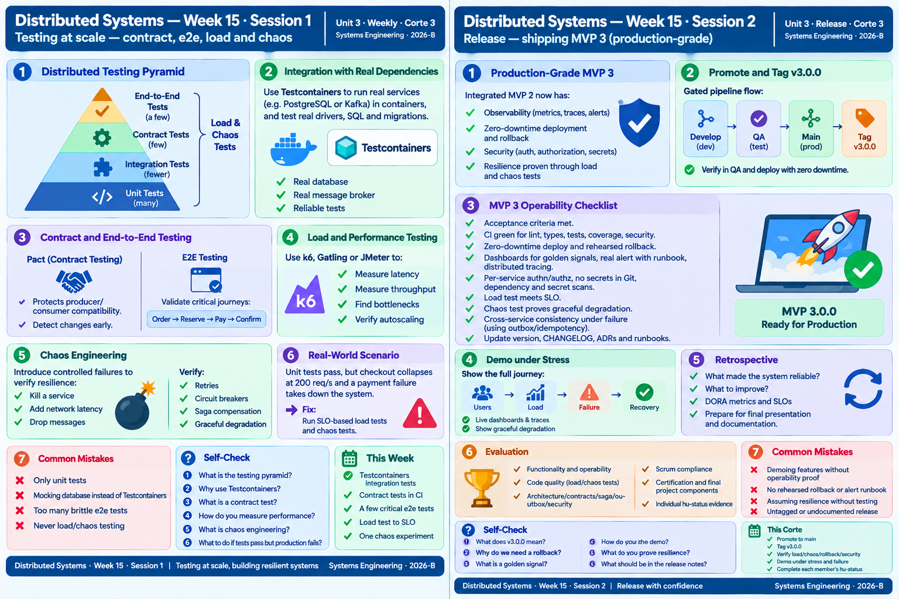

<!-- HU-STATUS TEMPLATE - do NOT remove the <!-- ... --> markers or the table headers.
     Your weekly grade is read AUTOMATICALLY from this file:
       15-week/hu-status/README.md  (inside YOUR fork). English. -->

# Weekly Status - Week 15

<!-- CONFIG-START - must match your profile repo (username/username) CONFIG -->
- FULL_NAME: Nicolas Obregon Rojas
- GITHUB_USER: nicolas1250
- TEAM: CineSync Platform
- SPRINT_GOAL: Ticketing released in v3.0.0: complete, secured and ready
<!-- CONFIG-END -->

## 1. User stories worked this week

Domain: Ticketing & Fulfillment (`csp-ticketing-api`, `-db`, `-portal`, with `csp-worker` and `csp-infra-rustfs`). Week: 2026-11-09 to 2026-11-15; state checked on GitHub on 2026-11-15. The stories were built mostly on 2026-11-06 and 2026-11-07 and **released this week**: `v3.0.0` was merged to `main` and tagged on 2026-11-14.

| HU ID | Title | Status (todo/doing/done) | Evidence (PR or commit URL) |
|---|---|---|---|
| HU-TICKETING-001 | Ticketing & Fulfillment maintains a local contact projection | done (released in `v3.0.0`; story issue closed 2026-11-07) | https://github.com/code-corhuila/csp-ticketing-api/pull/84 · https://github.com/code-corhuila/csp-ticketing-db/pull/23 |
| HU-TICKETING-002 | Ticket is issued and emailed after confirmation | done (released; worker and RustFS storage also in `qa` and `main`) | https://github.com/code-corhuila/csp-ticketing-api/pull/84 · https://github.com/code-corhuila/csp-worker/pull/24 · https://github.com/code-corhuila/csp-infra-rustfs/pull/8 |
| HU-TICKETING-003 | Duplicate event processing does not duplicate tickets | done (released) | https://github.com/code-corhuila/csp-ticketing-api/pull/52 · https://github.com/code-corhuila/csp-ticketing-api/pull/84 |
| HU-TICKETING-004 | Failed email delivery is retried | done (released; a delivery that cannot be processed is skipped and dispatching continues) | https://github.com/code-corhuila/csp-ticketing-api/pull/78 · https://github.com/code-corhuila/csp-ticketing-api/pull/84 |
| HU-TICKETING-005 | Client views reservation notifications | done (released: notifications, expired-reservation notice and hold-expiry warnings) | https://github.com/code-corhuila/csp-ticketing-api/pull/60 · /pull/67 · /pull/73 · /pull/74 · https://github.com/code-corhuila/csp-ticketing-db/pull/16 · /pull/21 |
| HU-TICKETING-006 | Client views their tickets | done (released) | https://github.com/code-corhuila/csp-ticketing-api/pull/69 |
| HU-FE-TICKETING-002 | Frontend shows my tickets from the Ticketing API | done (released) | https://github.com/code-corhuila/csp-ticketing-portal/pull/43 · /pull/45 · release: /pull/47 |
| HU-FE-TICKETING-003 | Frontend shows my notifications from the Ticketing API | done (released) | https://github.com/code-corhuila/csp-ticketing-portal/pull/42 · /pull/46 |
| REL-3.0.0 | Release 3.0.0 of the Ticketing domain (api, db, portal, worker, RustFS) | done (merged 2026-11-14, tag `v3.0.0`) | https://github.com/code-corhuila/csp-ticketing-api/pull/84 · https://github.com/code-corhuila/csp-ticketing-db/pull/23 · https://github.com/code-corhuila/csp-ticketing-portal/pull/47 · https://github.com/code-corhuila/csp-infra-rustfs/pull/8 |
| BUG-PORTAL-URL | The link in the ticket email must point to the shell of the platform | done (2026-11-11, `develop` and `qa`) | https://github.com/code-corhuila/csp-ticketing-api/pull/85 · https://github.com/code-corhuila/csp-ticketing-api/pull/86 |
| W13-WORKSHOP | Threat modeling of csp-api-gateway to csp-ticketing-api | done (merged 2026-11-09) | https://github.com/code-corhuila/csp-docs/pull/290 |
| SEC-S-291, SEC-T-292, SEC-E-293 | [security] token validation, PDF link and internal routes of Ticketing | done (issues closed 2026-11-06) | https://github.com/code-corhuila/csp-docs/issues/291 · /issues/292 · /issues/293 |

All the stories of the Ticketing epic (EP-004: HU-TICKETING-001 to 006 and HU-FE-TICKETING-001 to 003) are marked Done in `user-stories.md` of `csp-docs` (checked 2026-11-14).

## 2. My individual contribution

- **Threat model of Ticketing merged (docs #290, 2026-11-09):** the STRIDE analysis of the boundary csp-api-gateway to csp-ticketing-api and the three `[security]` stories I opened (#291, #292, #293) were all closed on 2026-11-06 after their implementation: the token validation of every protected route (api #36, mine) and the check of the PDF reference (api #59, Oscar).
- **Domain state audit after the release:** I checked on GitHub the state of the whole Ticketing domain (story issues, release PRs and tags in five repositories, which PRs are in `qa` and `main`, queue and grant configuration) and recorded it in the working notes of the project, so that the evidence of this report and the presentation is current.
- **Retrospective forum post:** wrote the post about the concession order that arrived before its booking (a `jsonb` column written as text, hidden by retries, and a race between two consumers) with the PRs #47 and #48 as evidence, and two references to the PostgreSQL documentation.
- **Preparation of the presentation:** a general review of `csp-docs`, the domains and the 25 repositories (architecture, 70 ADR, contracts, stories, repositories, process and risks) with a proposal of 20 slides.

## 3. Blockers and risks

- **GitHub Actions is still failing without running:** `build-and-test` and `track` of `csp-ticketing-api#86` fail in 1 to 2 seconds (2026-11-11), the same billing lock as before. The CI pipeline that was added to the API (#58) has therefore never run, and the release PRs were merged with local validation only.
- **No ADR for a PDF rendered before a late concession order.** The order normally arrives about 10 seconds after the booking, with no hard maximum, and the PDF job runs every 30 seconds. The case is still undocumented as a decision and as technical debt.
- **`csp-ticketing-api#18` (JWT public key of `qa` and `main`) is closed, but the repository has 0 GitHub environments** (checked 2026-11-15). It is not clear where the keys are loaded.
- **Configuration gaps found late:** the grant of the outbox reader role to the worker login (fixed on 2026-11-08) and the default portal URL of the ticket email (fixed on 2026-11-11) show that the deployment variables of Ticketing need an end-to-end check before each release.
- **The queue of `TicketIssued` has no consumer** (R-019); ADR-070 keeps it as a `drop-head` sink, so the risk is accepted, not removed.
- The issues are not in the team board: my `gh` token lacks the project scope.

## 4. Plan for next week

- Run the whole Ticketing flow on the platform composition (booking, ticket, PDF in RustFS, email in the dev catcher) and use it as the demo of the presentation.
- Write the decision on the PDF rendered before a late concession order (ADR or decision of the service, plus a technical-debt item) and update the runbook.
- Confirm where `JWT_PUBLIC_KEY` of `qa` and `main` is loaded for `csp-ticketing-api` and answer on #18 if the environments are missing.
- When Actions works again, re-run the workflows of the PRs merged with local validation only and record the result.
- Rehearse and deliver the presentation.

## 5. Compliance self-check

- [x] Conventional Commits - `type(scope): summary`
- [ ] Per-environment HU branch + PR to that environment (hu-xxx-dev -> develop, ...)
- [x] Testable acceptance criteria
- [x] Tests added/updated (unit / integration)
- [x] DDD / hexagonal boundaries respected (domain has no I/O)
- [x] No secrets; config via environment variables

Note on the second item: the PRs follow the team model `feat/` or `fix/` to `develop`, `qa-promote/<repo>-<story>-<n>` to `qa` (ADR-021) and `release/3.0.0` to `main`, not branches named `hu-xxx-dev`.

## 6. Evidence links

- Release 3.0.0: https://github.com/code-corhuila/csp-ticketing-api/pull/84 · https://github.com/code-corhuila/csp-ticketing-db/pull/23 · https://github.com/code-corhuila/csp-ticketing-portal/pull/47 · https://github.com/code-corhuila/csp-infra-rustfs/pull/8 · https://github.com/code-corhuila/csp-worker/pull/24
- Notifications and tickets: https://github.com/code-corhuila/csp-ticketing-api/pull/60 · https://github.com/code-corhuila/csp-ticketing-api/pull/69 · https://github.com/code-corhuila/csp-ticketing-portal/pull/43 · https://github.com/code-corhuila/csp-ticketing-portal/pull/42
- Portal URL of the email: https://github.com/code-corhuila/csp-ticketing-api/pull/85 · https://github.com/code-corhuila/csp-ticketing-api/pull/86
- Security: https://github.com/code-corhuila/csp-docs/pull/290 · https://github.com/code-corhuila/csp-docs/issues/291 · https://github.com/code-corhuila/csp-docs/issues/292 · https://github.com/code-corhuila/csp-docs/issues/293 · https://github.com/code-corhuila/csp-ticketing-api/pull/36 · https://github.com/code-corhuila/csp-ticketing-api/pull/59
- Concession race (forum post): https://github.com/code-corhuila/csp-ticketing-api/pull/47 · https://github.com/code-corhuila/csp-ticketing-api/pull/48
- Outbox reader grant and queue decision: https://github.com/code-corhuila/csp-ticketing-db/pull/24 · https://github.com/code-corhuila/csp-docs/pull/370
- Failed checks (billing lock): https://github.com/code-corhuila/csp-ticketing-api/actions/runs/43105636297

